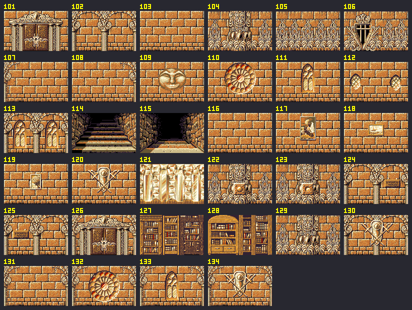
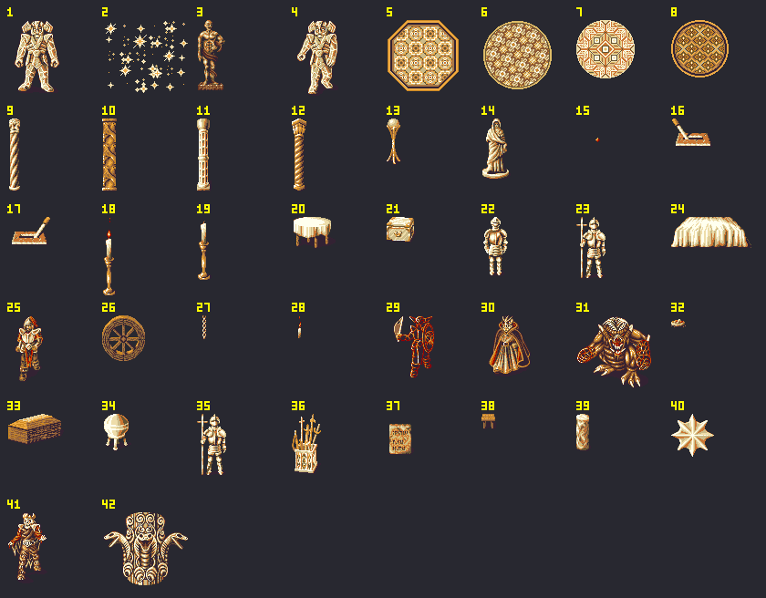

# Labdata 46 – Basis für die Ratsechsen-Tempel

Labdata 46 ist eine Kopie der Gala-Labdata 5 (Boden 20, Decke 8) mit vier zusätzlichen Wänden (131–134) und dem Schlangentotem (Objektgruppe 40). Zusammen mit **Palette 59 „Wüstentempel“** wird daraus Sandstein, ohne dass neue Grafiken nötig sind.

Gebaut wird sie von `tools/build_prototype.py`. Erster Einsatz: Prototyp S'Riel (Map 487).

## Palette 59 „Wüstentempel“

| Index | Farbe | Bedeutung (wie in Palette 6) |
|---|---|---|
| 1, 2, 3 | `ffe eda cb8` | hellste Stufen: Glanzlichter cremeweiß, Kanten sandgrau |
| 12 | `db6` | heller Zwischenton, ockergelb (in Palette 6 Moos-Grün) |
| 4 | `c73` | Grundton der Steine, gebranntes Orange |
| 13 | `964` | dunkler Zwischenton, graubraun (in Palette 6 Moos-Grün) |
| 5, 6 | `653 323` | Schatten und Fugen, kühl |
| 7–11 | wie Palette 6 | Holz, Gold (Türen, Regale, Truhen) |
| 14, 15 | wie Palette 6 | Rot (Rosette, Wachen, Flammen) |
| 16–31 | wie Palette 6 | |

Ausgangspunkt war ein Helligkeitsabgleich von Wand 99 mit der Sandstein-Vorlage (`textures/Pixel-Art-Sandsteinwand mit Tempelfriesen.png`). Danach haben die Stufen unterschiedliche Farbtöne bekommen (gelb, orange, graubraun, kühle Schatten), damit die Steine nicht eintönig wirken. Weil die Bedeutung der Indizes gleich bleibt, passen alle Wände, Overlays und Objekte des Spiels automatisch dazu. Graue Monster werden in 3D mit eingefärbt.

## Wände

„Begehbar“ heißt: Die Gruppe kann hindurchgehen. Das wird für Türen und Treppen mit einem Ereignis genutzt, oder für Scheinwände.

| Nr. | Textur | Overlays | Begehbar | Beschreibung |
|---|---|---|---|---|
| 101 | 96 | | ja | Prunktür |
| 102 | 98 | | | Doppelbogen mit Säulen |
| 103 | 99 | | | **Grundwand** (Quader mit Sockelfries) |
| 104 | 100 | | | Reliefpfeiler mit Edelsteinen |
| 105 | 103 | | | Relieffries |
| 106 | 104 | | | Dunkles Tor im Relief |
| 107 | 99 | 24 links | | Grundwand mit Säulenrahmen links |
| 108 | 99 | 25 rechts | | Grundwand mit Säulenrahmen rechts |
| 109 | 99 | 39 | | Steinkopf (Rätselmund) |
| 110 | 99 | 71 | | Rosettenfenster |
| 111 | 99 | 72 | | Spitzbogenfenster |
| 112 | 99 | 73, 73 | | Zwei kleine Fenster |
| 113 | 98 | 72, 72 | | Bögen mit Fenstern |
| 114 | 125 | | ja | Treppe hoch |
| 115 | 126 | | ja | Treppe runter |
| 116 | 99 | | ja | **Scheinwand** (sieht aus wie 103) |
| 117 | 99 | 67 | | Gemälde (Landschaft) |
| 118 | 99 | 68 | | Gemälde mit Schiff auf dem Wasser, **nicht für Morag** (kein Wasser) |
| 119 | 99 | 69 | | Kleines Gemälde (Pflanze) |
| 120 | 99 | 74 | | Wappen mit gekreuzten Waffen |
| 121 | 58 | | | Vorhang- bzw. Marmorwand |
| 122 | 100 | 133 | | Reliefpfeiler mit Schalter (aus) |
| 123 | 100 | 134 | | Reliefpfeiler mit Schalter (an) |
| 124 | 98 | 135 | | Bögen mit Schild rechts |
| 125 | 98 | 136 | | Bögen mit Schild links |
| 126 | 96 | 96, 97 | ja | Prunktür mit Säulenrahmen |
| 127 | 167 | | | Bücherregal |
| 128 | 168 | | | Bücherregal (Bogen) |
| 129 | 100 | | ja | **Scheinwand** (sieht aus wie 104) |
| 130 | 98 | 137 | | Bögen mit Wappen |
| 131 | 99 | 24, 25 | | **neu:** Grundwand mit Säulenrahmen auf beiden Seiten |
| 132 | 99 | 24, 25, 71 | | **neu:** Rosette zwischen Säulenrahmen |
| 133 | 99 | 24, 25, 72 | | **neu:** Fenster zwischen Säulenrahmen |
| 134 | 99 | 24, 25, 74 | | **neu:** Wappen zwischen Säulenrahmen |

Im Map-Feld steht die Wandnummer direkt (101 = erste Wand). Weitere Overlays (Schalter, Schilder, Rätselmund, Ketten …) lassen sich jederzeit als neue Wände anhängen. Overlays müssen auf dem Amiga an 8-Pixel-Grenzen liegen (x = 0, 8, 16, …).

## Objektgruppen

Die Bilder oben sind nach **Objekt** nummeriert, die Karte verwendet **Gruppen**. Die Gruppen 1–25 entsprechen den Objekten 1–25.

| Gruppe | Objekt(e) | Beschreibung |
|---|---|---|
| 1, 4 | 1, 4 | Golemstatue (4 animiert, „lebende Statue“) |
| 2 | 2 | Funkeln (Magie, Teleporter) |
| 3 | 3 | Bronzestatue |
| 5–8 | 5–8 | Bodenmosaike (achteckig, rund) |
| 9–12 | 9–12 | Säulen (gedreht, verziert, schlank, gedreht hell) |
| 13 | 13 | Kleiner Ständer |
| 14 | 14 | Statue in Robe |
| 15 | 15 | Kleiner Funke |
| 16, 17 | 16, 17 | Bodenhebel (zwei Stellungen) |
| 18, 19 | 18, 19 | Kerzenständer (brennend, aus) |
| 20 | 20 | Runder Tisch mit Decke |
| 21 | 21 | Truhe |
| 22, 23 | 22, 23 | Ritterrüstungen, **passen nicht in den Wüstentempel** |
| 24 | 24 | Bett bzw. verhängter Steinblock |
| 25 | 25 | Gerüsteter Krieger (animiert) |
| 26 | 26–28 | Rad mit Dolchen |
| 27 | 29 | **Magische Wache** (Grafik für Monster auf der Karte) |
| 28 | 30, 29 | Moraner in Robe mit zwei Wachen |
| 29 | 31 | Dämon |
| 30 | 32 | Kleiner Gegenstand |
| 31 | 33 | Steinplatten bzw. Steinhaufen |
| 32 | 34, 20 | Kugel auf Dreifuß neben Tisch |
| 33 | 37, 35 | Steintafel und Rüstung |
| 34 | 36 | Waffenständer |
| 35 | 20, 38 | Tisch mit zwei Hockern |
| 36 | 40, 39, 18 | Stern über Säulenstumpf, Kerze |
| 37 | 41 | Krieger (animiert) |
| 38, 39 | 37 | Steintafel (links bzw. rechts versetzt) |
| 40 | 42 | **neu:** Schlangentotem (aus Sansris Tempel, Textur 28) |

Für die Wüstentempel gut geeignet sind: Säulen, Mosaike, Statuen, Golems, Kerzen, Tisch, Truhe, Kugel, Steintafeln, Stern, Funkeln und das Schlangentotem. Die Rüstungen (22, 23, 33) und das Schiffsgemälde (118) besser nicht verwenden.
