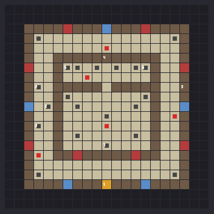
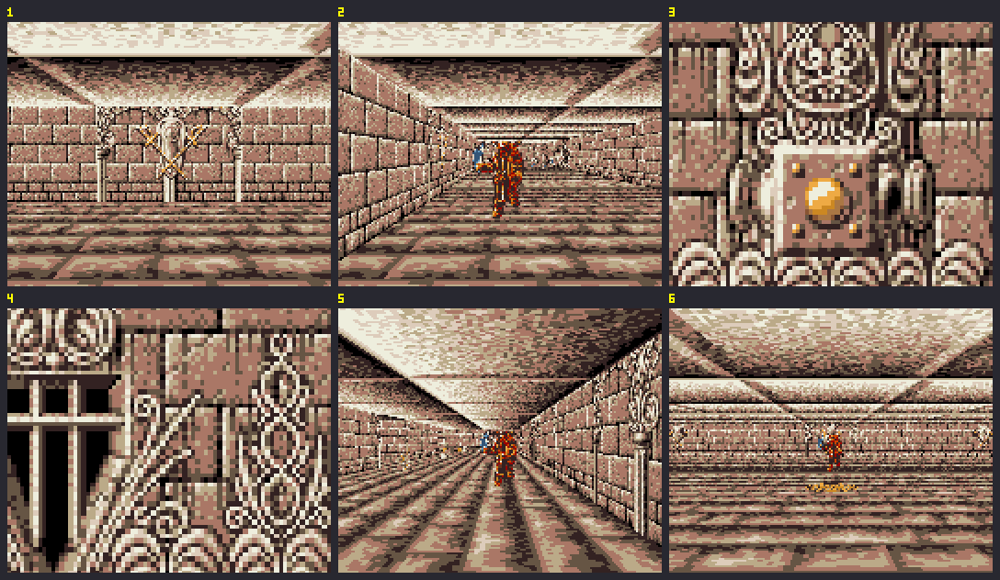
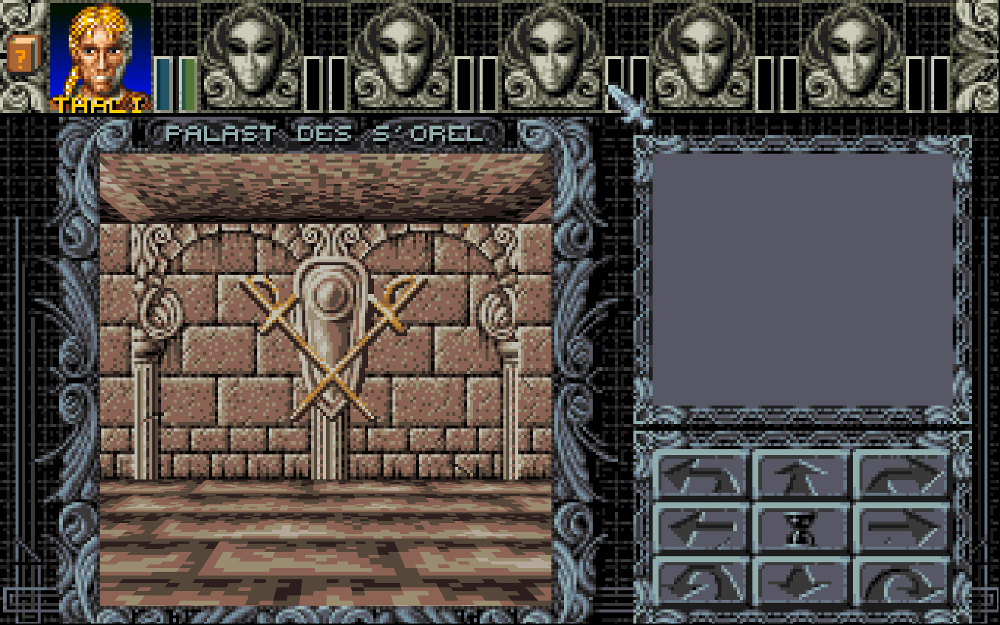
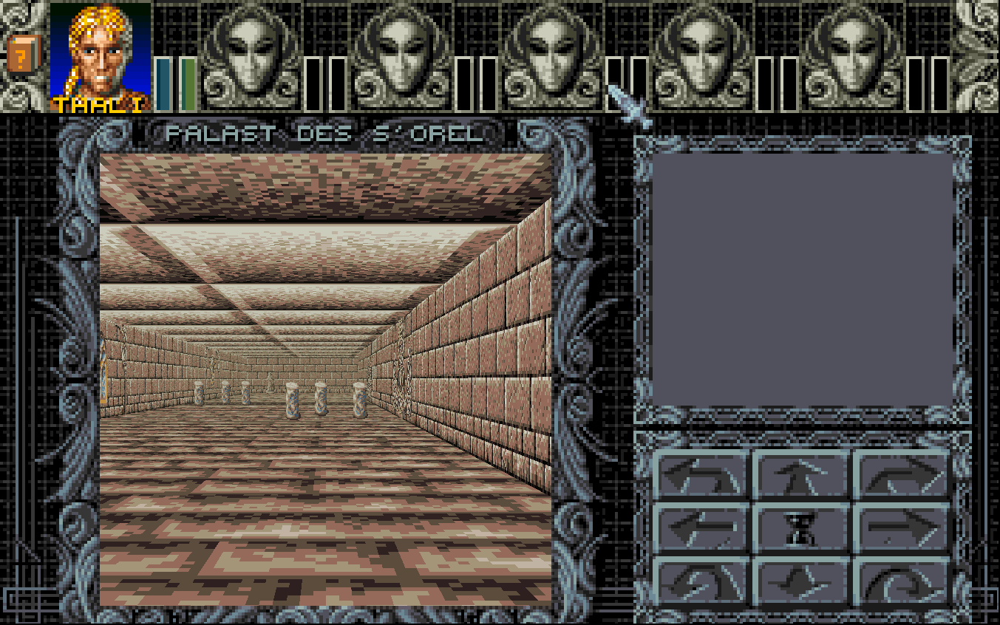
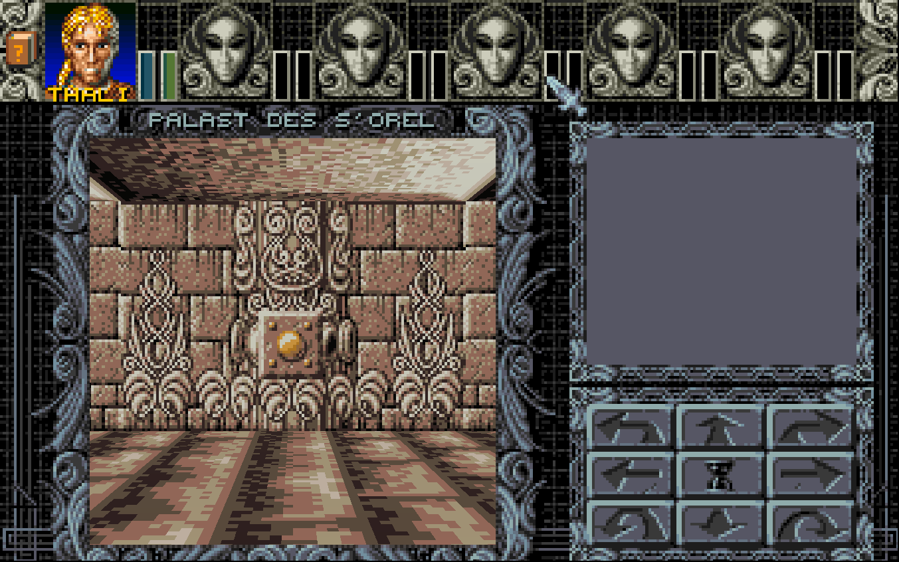
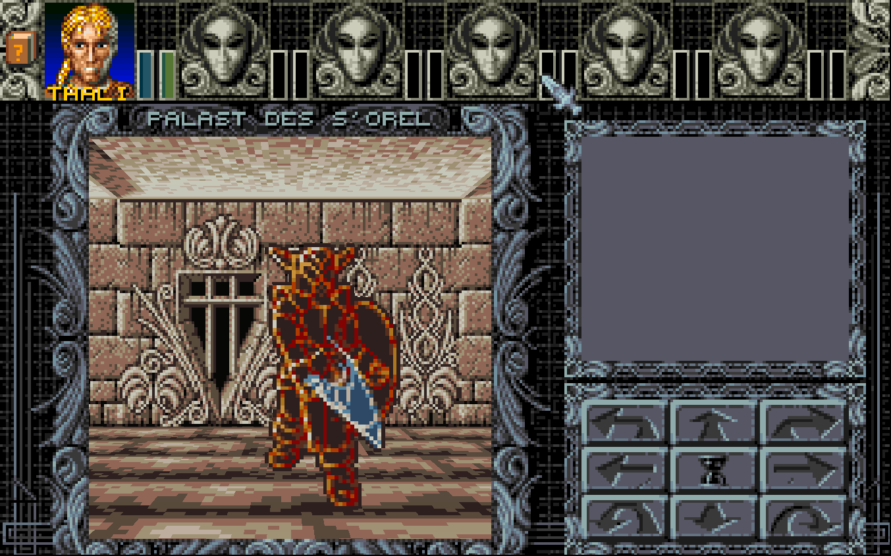
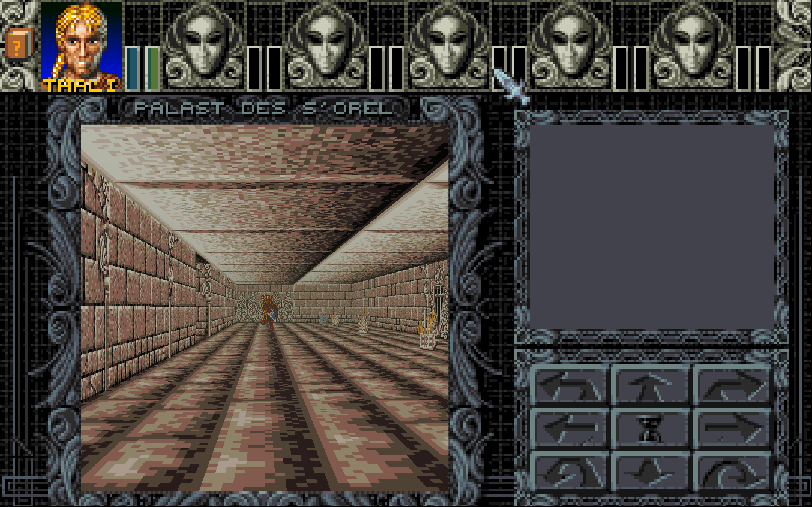
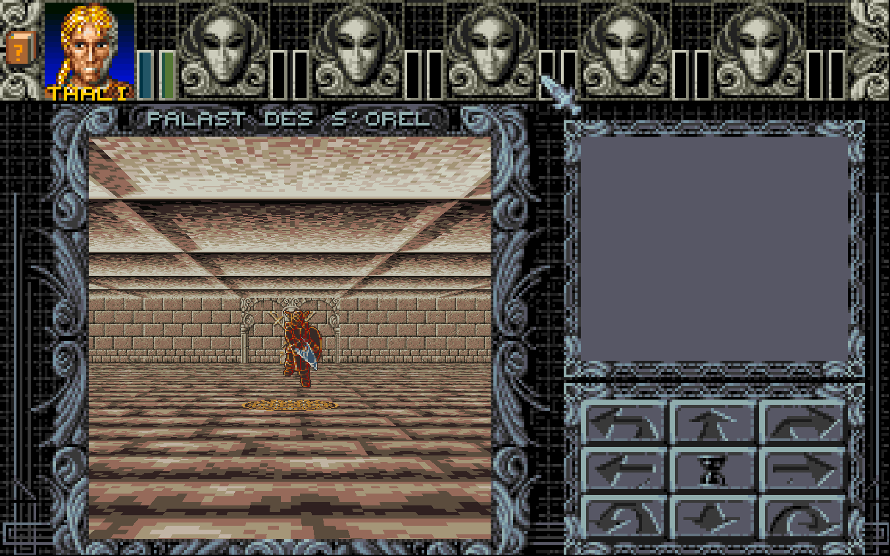

# Tempel-Prototypen

| Map | Tempel | Palette |
|---|---|---|
| 487 | S'Riel (Bibliothek) | 59 „Wüstentempel“ |
| 488 | S'Orel (Kaserne) | 60 „Kaserne“ (dunkler, bräunlicher Sandstein, stahlblaue Akzente) |

Spielbare Testmaps für die Neugestaltung der Ratsechsen-Tempel. Die echten Tempel 444–450 bleiben unverändert, bis ein Prototyp passt.

Gebaut wird mit `python assets/Temples/tools/build_prototype.py` (schreibt in `german/Amberfiles` und AllTexts DE/EN). Mit `--preview-only` werden nur die Vorschaubilder erzeugt.

## Testen auf dem Amiga

1. AM2_CPU-Cheat-Version und die aktuellen Daten auf die FS-UAE-Platte bringen.
2. **Neues Spiel starten.** Alte Spielstände haben keine Automap-Einträge für die Maps 485–487 und enden beim Betreten in einem Fatal Error. Das muss später der Savegame-Patcher erledigen.
3. Im Spiel `t` drücken und `487` bzw. `488` eingeben. Die Gruppe landet auf (5,5) in der Bibliothek, direkt neben dem losen Buch.

## Testen im Remake

`python tools/ambtools/make_testdata.py <ordner>` erzeugen und dann z. B. `Ambermoon.net --data <ordner>/Amberfiles --skip-intro --load 0 --cheat 3 "teleport 487 9 4 up" --screenshot 5 --exit-after 7` starten. Die Bilder `487_remake_*.png` sind so entstanden.

## 487 – Palast des S'Riel (Pilot)

- **Optik:** Labdata 46, die Tempel-Basis (siehe `../Labdata 46.md`): Gala-Wände und Overlays mit Palette 59 („Wüstentempel“) in Sandstein. Grundwand 103 (Textur 99), Säulenrahmen, Rosette, Fenster, Wappen, Steinköpfe, Reliefpfeiler und Prunktür als Ausgang. Musik vorerst Song 22, weil Song 33 noch nicht in Music.amb ist (siehe `../music/README.md`).
- **Grundriss** (17×17): Empfangshalle in der Mitte, ringsum Bibliothek (West), Ostflügel, Foyer (Süd) und das Schlafgemach (Nord).
- **Ankunft:** wie im Original in der Halle (9,10). S'Arin erscheint, die zwei magischen Wachen greifen an.
- **Bibliothek:** Bücherregale auf beiden Seiten. Vier Regale lassen sich mit dem Auge lesen (Kette 3–6), mit Hinweisen auf S'Arin, S'Endar, S'Trog, S'Kat und S'Lorwin. Das letzte Regal verrät das lose Buch.
- **Geheimgang:** Das lose Buch im Regal direkt an der Nordwand der Bibliothek (2,4) wird mit der Hand gezogen (von (3,4) aus nach Westen). Dann öffnet sich die Wand (6,4) zum Schlafgemach.
- **Schlafgemach:** Bett, Tagebuch auf dem Tisch (Auge) und Truhe 116.
- **Ostflügel:** Statue, Schlangentotem (aus Sansris Tempel, Objektgruppe 40) und Truhe 117. Die Truhen sind dieselben wie in Map 444, nur für den Test.
- **Ausgang:** Tür im Foyer (9,15) zur Weltkarte 520 (37,41), wie in 444.

| Kette | Feld | Inhalt |
|---|---|---|
| 1 | (9,15) | Ausgang nach Morag |
| 2 | (9,10) | Ankunftstext (Text 1 aus 444), danach deaktiviert |
| 3–6 | (2,6), (2,8), (2,10), (2,12) | Lesbare Regale (Texte 2–5) |
| 7 | (2,4) | Loses Buch: Hand → Text 6, Wand (6,4) öffnet sich, Kette deaktiviert |
| 8 | (11,3) | Tagebuch (Text 7) |
| 9, 10 | (7,3), (15,4) | Truhen 116 und 117 |

## 488 – Palast des S'Orel (Kaserne)

Nach Tempelanalyse.md: Außengang mit Wachen, ganz hinten das Tor zum Innenbereich (Schlüssel nötig), innen Truhe und große Wächtergruppe. Keine Karte. Mit Licht (das Original 445 war dunkel).

- **Außengang** (2 breit) rund um das Hallengebäude. Ausgang im Süden (11,19) zur Weltkarte 525 (33,28), wie in 445.
- **Wachen im Gang:** Gruppe 67 (2 Wachen) im Osten, Gruppe 68 (4) vor dem Tor und im Westen.
- **Spießfalle** im Westgang (4,9), (5,11), (4,13), Text und Falle wie in 445. Ein Schalter am Reliefpfeiler im Ostgang (19,9) legt sie still (Text wie in 445).
- **Tor** im Norden (11,6): Tür 33 mit Schlüssel 388 „Palast S'Orel“ (aus S'Riels Truhe 117), wie in 445. Danach ist der Durchgang offen.
- **Waffenkammer:** vier Waffenständer, Truhe 118 (Morag-Robe, Morag-Dart), 2 Wachen, Steintafel mit dem Dienstplan der Wache (Hinweis auf S'Arin und die Truhe).
- **Übungshalle:** Golemstatuen, Säulen, Mosaik, die neue große Gruppe 172 (6 magische Wachen) und Truhe 119 mit Schlüssel 389 „Palast S'Arin“.

Offen: echte stärkere Wachen (bisher gibt es nur die magische Wache, Monster 42). Die Truhen 118/119 und Tür 33 teilt sich der Prototyp mit Map 445.

| Kette | Feld | Inhalt |
|---|---|---|
| 1 | (11,19) | Ausgang nach Morag |
| 2 | (4,9), (5,11), (4,13) | Spießfalle (Text 1 + Falle) |
| 3 | (19,9) | Schalter: Hand → Text 2, Schalter umgelegt, Spieße weg, Falle aus |
| 4 | (11,6) | Tor: Hand → Tür 33, Schlüssel 388 → offen |
| 5 | (7,7) | Dienstplan (Text 3) |
| 6, 7 | (15,7), (11,15) | Truhen 118 und 119 |
