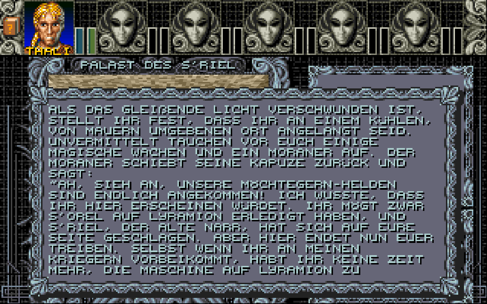
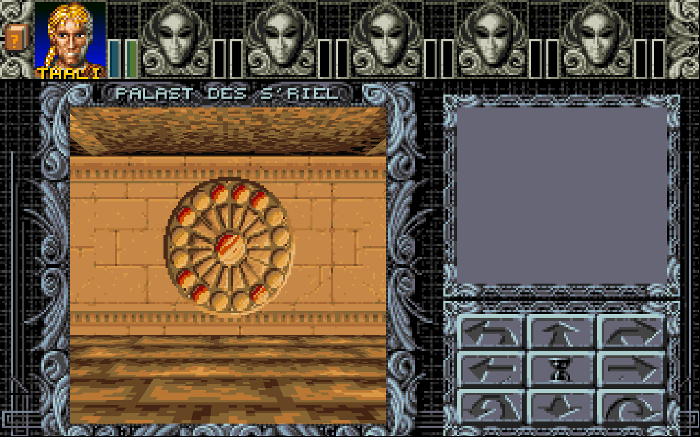
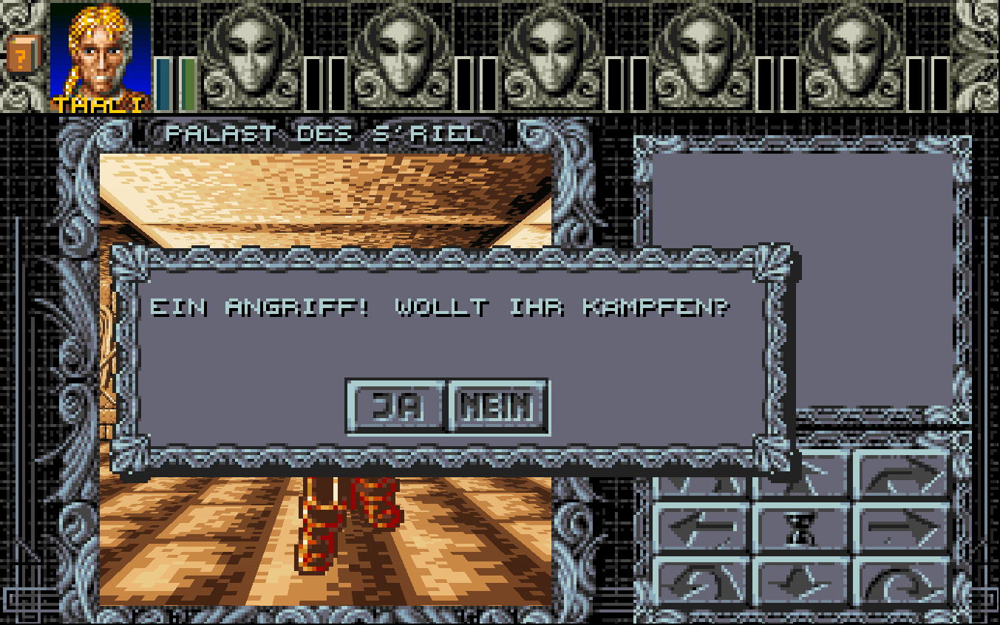
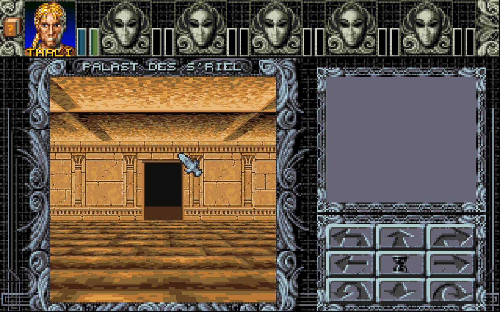
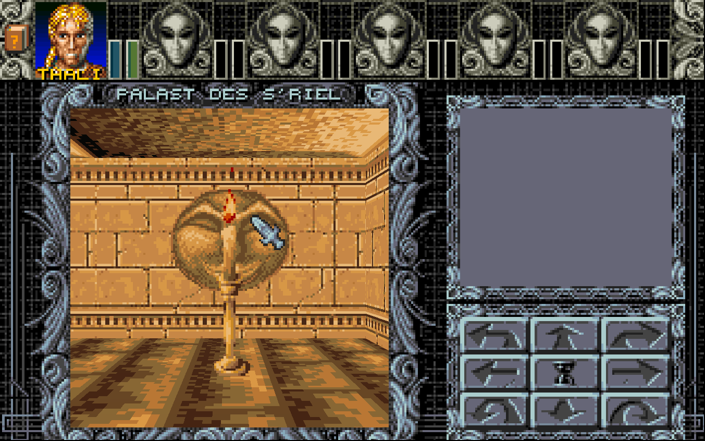
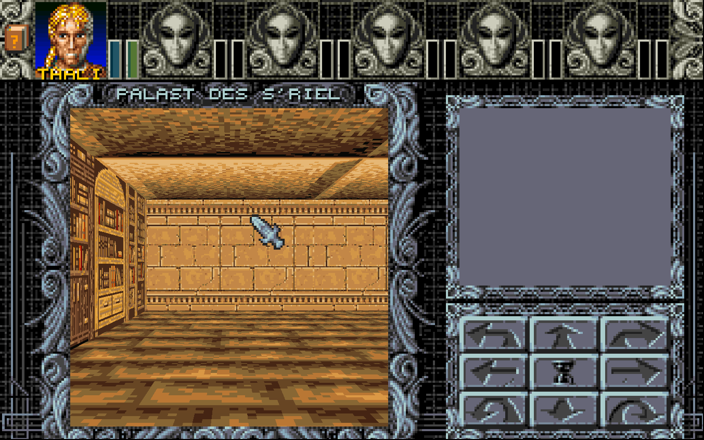
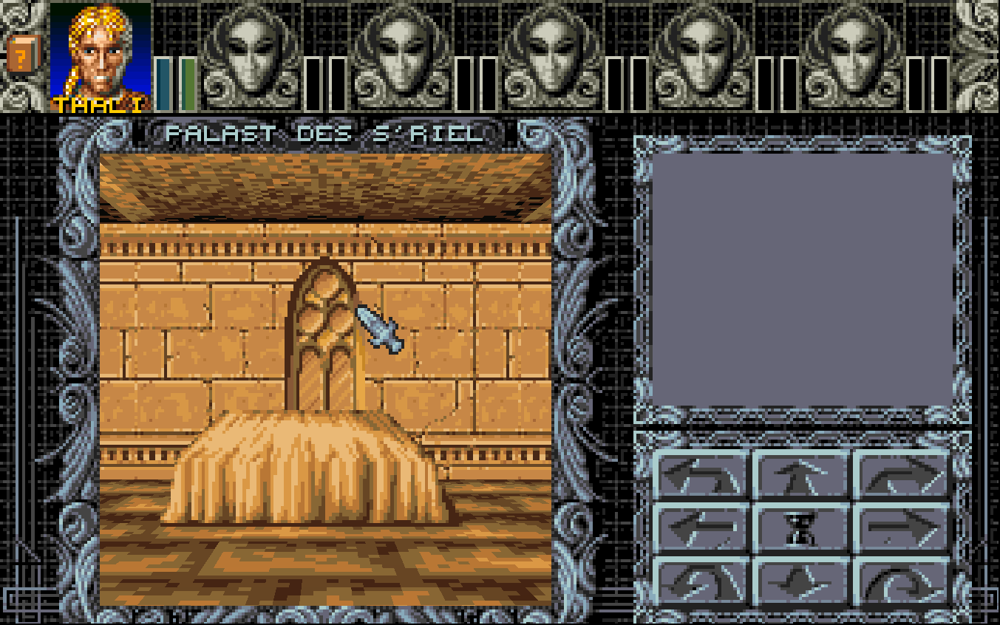
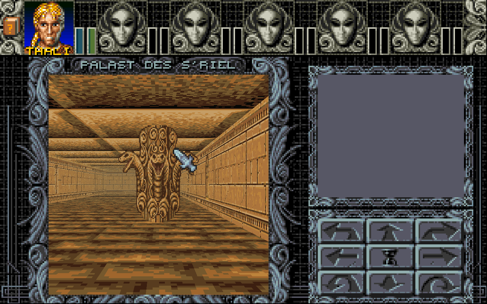
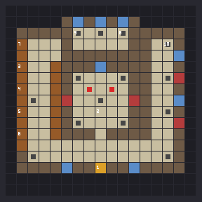
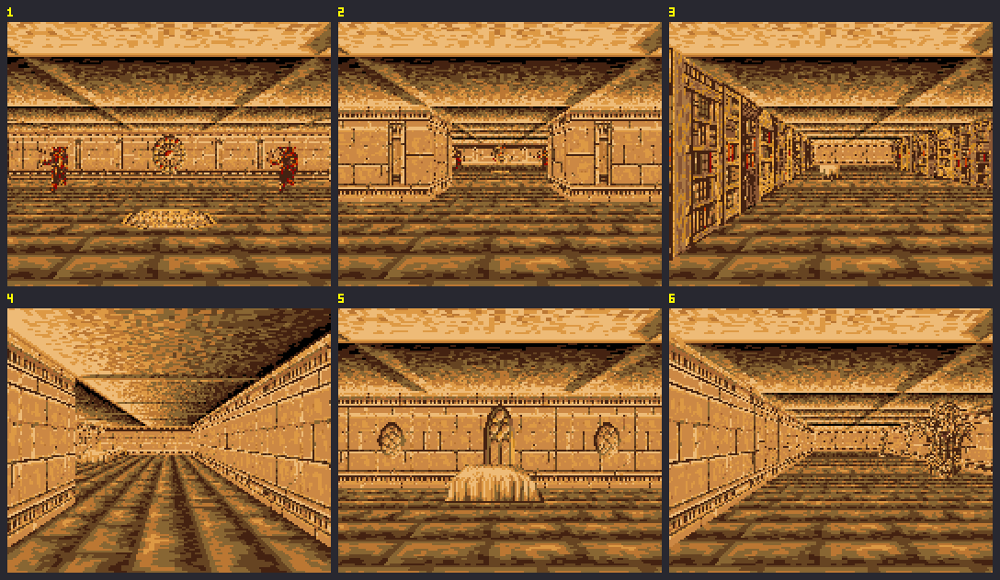

# Tempel-Prototypen

Spielbare Testmaps für die Neugestaltung der Ratsechsen-Tempel. Die echten Tempel 444–450 bleiben unverändert, bis ein Prototyp passt.

Gebaut wird mit `python assets/Temples/tools/build_prototype.py` (schreibt in `german/Amberfiles` und AllTexts DE/EN). Mit `--preview-only` werden nur die Vorschaubilder erzeugt.

## Testen auf dem Amiga

1. AM2_CPU-Cheat-Version und die aktuellen Daten auf die FS-UAE-Platte bringen.
2. **Neues Spiel starten.** Alte Spielstände haben keine Automap-Einträge für die Maps 485–487 und enden beim Betreten in einem Fatal Error. Das muss später der Savegame-Patcher erledigen.
3. Im Spiel `t` drücken und `487` eingeben. Die Gruppe landet auf (5,5) in der Bibliothek, direkt neben dem losen Buch.

## Testen im Remake

`python tools/ambtools/make_testdata.py <ordner>` erzeugen und dann z. B. `Ambermoon.net --data <ordner>/Amberfiles --skip-intro --load 0 --cheat 3 "teleport 487 9 4 up" --screenshot 5 --exit-after 7` starten. Die Bilder `487_remake_*.png` sind so entstanden.

## 487 – Palast des S'Riel (Pilot)

- **Optik:** Labdata 46 ist eine Kopie der Gala-Labdata 5 mit Boden 20 und Decke 8. Dazu kommen die neuen Sandsteinwände 193–195 (Wände 131–138, mit Fenster, Wappen, Rosette und Gemälden als Overlays) und Palette 59 („Wüstentempel“). Von Gala bleiben nur Bücherregale und Objekte. Musik vorerst Song 22, weil Song 33 noch nicht in Music.amb ist (siehe `../music/README.md`).
- **Grundriss** (17×17): Empfangshalle in der Mitte, ringsum Bibliothek (West), Ostflügel, Foyer (Süd) und das Schlafgemach (Nord).
- **Ankunft:** wie im Original in der Halle (9,10). S'Arin erscheint, die zwei magischen Wachen greifen an.
- **Bibliothek:** Bücherregale auf beiden Seiten. Vier Regale lassen sich mit dem Auge lesen (Kette 3–6), mit Hinweisen auf S'Arin, S'Endar, S'Trog, S'Kat und S'Lorwin. Das letzte Regal verrät das lose Buch.
- **Geheimgang:** Das lose Buch im Regal direkt an der Nordwand der Bibliothek (2,4) wird mit der Hand gezogen (von (3,4) aus nach Westen). Dann öffnet sich die Wand (6,4) zum Schlafgemach.
- **Schlafgemach:** Bett, Tagebuch auf dem Tisch (Auge) und Truhe 116.
- **Ostflügel:** Statue, Schlangentotem (aus Sansris Tempel, Objektgruppe 40) und Truhe 117. Die Truhen sind dieselben wie in Map 444, nur für den Test.
- **Ausgang:** Tür im Foyer (9,15) zur Weltkarte 520 (37,41), wie in 444.

| Kette | Feld | Inhalt |
|---|---|---|
| 1 | (9,15) | Ausgang nach Morag |
| 2 | (9,10) | Ankunftstext (Text 1 aus 444), danach deaktiviert |
| 3–6 | (2,6), (2,8), (2,10), (2,12) | Lesbare Regale (Texte 2–5) |
| 7 | (2,4) | Loses Buch: Hand → Text 6, Wand (6,4) öffnet sich, Kette deaktiviert |
| 8 | (11,3) | Tagebuch (Text 7) |
| 9, 10 | (7,3), (15,4) | Truhen 116 und 117 |
